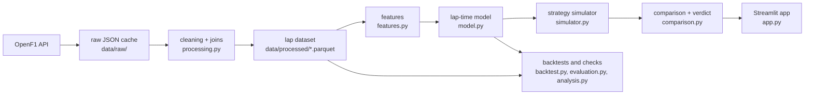

# PitWall

A small F1 race-strategy simulator built on historical timing data. Pick a race and a car, and
PitWall shows the strategy that car really ran, then estimates how its race time would have changed
under a few other pit strategies, and how far to trust the comparison.

A learning project, not affiliated with Formula 1, the FIA or FOM. It estimates lap-time loss that
goes with tyre age under a simple model. It does **not** find the best strategy.

## What it answers

> What would this driver's total race time have been if they had pitted on different laps, or used
> different compounds?

The app (`app.py`) gives, for one car in one race:

- a one-line verdict: does the model prefer another strategy, and how sure can you be (see
  [Evaluation](#evaluation) for what "sure" means);
- a dot-and-range chart of each alternative's time against the real strategy;
- a lap-by-lap chart of where the time is won or lost (pit stops are steps, tyre age is the slope);
- your own strategy, typed in and checked (wrong number of stops, one compound only, pit laps out of
  order and so on give a plain error, not a crash).

Comparisons are between strategies for **one car in one race**. PitWall does not compare drivers and
does not estimate finishing positions.

## Setup

Requires [uv](https://docs.astral.sh/uv/) (it installs the pinned Python 3.13 and dependencies).

```bash
uv sync
uv run pytest -q                      # tests never call the live API
```

The app needs the processed dataset, which is not in the repository (`data/` is git-ignored; a
90 KB subset used by the tests is in `tests/fixtures/`). To build it from the OpenF1 API:

```bash
uv run python scripts/fetch_races.py        # caches raw JSON in data/raw/ (15 races, 3 s between requests)
uv run python scripts/build_dataset.py      # data/processed/lap_dataset.parquet + docs/DATA_QUALITY.md
uv run python scripts/build_driver_names.py # data/processed/driver_names.json (optional: car numbers otherwise)
uv run python scripts/build_neutralisations.py # data/processed/neutralisations.json (safety-car windows; races with one are hidden without it)
uv run streamlit run app.py
```

Every API response is cached, so re-running only fetches what is missing.

## How it works



| Module | Job |
|---|---|
| `ingestion.py` | Fetch and cache OpenF1 endpoints (laps, stints, race control, weather, drivers) |
| `processing.py` | Join laps to stints, label every lap with exclusion reasons, build the dataset, quality report |
| `features.py` | Lap time relative to the driver's median clean lap (the target), race fraction (fuel proxy) |
| `model.py` | Pooled linear model: compound, tyre age, race fraction, per compound-and-circuit wear adjustments pulled toward a shared rate |
| `analysis.py` | Pit loss and lap-1 loss per circuit, residual trends, observed tyre-age ranges |
| `simulator.py` | A strategy becomes predicted lap times and a race total; validation; out-of-range flags |
| `traffic.py` | Lap-time penalty by gap to the car ahead; the real field replayed from lap start times |
| `neutralisation.py` | Safety-car and virtual-safety-car windows; the field's real lap times on those laps; the cost of a stop under a real safety car |
| `backtest.py`, `evaluation.py` | Real strategies run through the simulator; metrics and train/test splits |
| `comparison.py` | The candidate strategies, rankings, sensitivity, verdict: everything the app displays |

The app only displays; every number comes from `comparison.py`.

### The model, in plain words

Each lap's time is predicted as the driver's own median clean lap plus a delta:
`delta = compound offset + tyre-age slope × tyre age + fuel term × race fraction`. The fuel term also
absorbs the track getting faster. Tyre age restarts at each stop; race fraction does not. The wear
slope is shared, with a small adjustment per compound at each circuit (partial pooling, so a pair
with few laps stays close to the shared rate). **This is tyre-age-associated lap-time loss, not
physical tyre wear.**

A strategy is a plain dict: compounds per stint and the laps pitted on. A stop costs the circuit's
pit loss (pit-lane time minus the same stretch at racing speed, measured per circuit).

## Data

- Source: the [OpenF1](https://openf1.org) API, historical data only.
- 15 dry, non-sprint races: Sakhir (Bahrain), Hungaroring, Monza, Singapore and Yas Marina (Abu
  Dhabi), each in 2023, 2024 and 2025. 17,100 laps, 15,468 of them clean (not lap 1, a pit in-lap
  or out-lap, a safety-car lap, a retirement lap or a lap with missing data). Counts and every
  exclusion rule are in
  [`docs/DATA_QUALITY.md`](docs/DATA_QUALITY.md); the audit of the API is in
  [`docs/DATA_AUDIT.md`](docs/DATA_AUDIT.md).
- 4 of the 15 races had a safety car or virtual safety car: real safety cars at Singapore 2023 (laps
  20-22) and Sakhir 2025 (laps 32-35), virtual ones at Sakhir 2023 (41-42), Singapore 2023 (44-45) and
  Yas Marina 2024 (2-3). They are replayed from `race_control` (see below); the model itself is never
  trained on those laps.
- Raw data is kept apart from processed data; joins are on `session_key`, `driver_number` and
  `lap_number`, with key-uniqueness and row-count checks.

## Evaluation

Rules: the model is trained on 2023 and 2024, and 2025 is never used to choose or tune anything
(it is reported once). Never a random split of laps within a race. Choices are made with
leave-one-year-out on 2023/24 (fit on one year, score the other).

**Lap-time model**, 2025 races (out of sample), seconds per lap, against predicting "every lap is the
driver's normal lap":

| | Clean laps MAE | RMSE | Bias | All racing laps MAE |
|---|---:|---:|---:|---:|
| Zero baseline | 0.792 | 1.129 | +0.022 | 0.955 |
| PitWall model | **0.612** | 0.952 | +0.146 | **0.764** |

The model is worse than the baseline on tyres 30+ laps old in 2025 (bias +0.71 s: old tyres lost
less time than the straight-line wear predicts). That bias is not present in 2023/24, so it is
treated as a 2025 effect and reported, not modelled
([DECISIONS](DECISIONS.md), 2026-11-18).

**Whole-race backtest**: each driver's real strategy run through the simulator, safety-car-free
2023/24 races, each scored by a model fitted on the other year: mean absolute error **9.6 s** per
race total with traffic (76 driver-races, about 0.16 s per lap); 10.4 s without traffic, 11.8 s when
the car's pace is taken from the whole race instead of its first half.

**Do strategy gaps come out right?** The app compares strategies, so the check that matters is
pairs of cars in the same race that ran different strategies (320 pairs 2023/24 cross-year, 244
pairs in 2025). Each car's pace is taken from its first half and only the second half is scored:

| | Model gap error | "No strategy effect" error | Picks the faster car (real gap > 5 s) |
|---|---:|---:|---:|
| 2023/24 cross-year, traffic off | 11.2 s | 12.8 s | 70% |
| 2023/24 cross-year, **traffic on** | **10.5 s** | 12.5 s | 71% |
| 2025, traffic off | 10.9 s | 15.7 s | 76% |
| 2025, **traffic on** | **10.7 s** | 15.5 s | 82% |

With traffic on, the predicted faster car really was faster about 55% of the time when the predicted
gap was under 3 s, about 2 times in 3 between 3 and 10 s, and 84% (2023/24) to 94% (2025) above 10 s.
That is why the verdict says "too close for the model to call" under 3 s.

**Safety cars** are replayed, not predicted. On a lap under a safety car or virtual safety car the
simulator uses the field's real lap time; a stop whose in-lap is under a real safety car costs about 68%
of the circuit's normal pit loss (median of 14 real stops at Singapore 2023, the only real safety car
in the training years); a stop under a virtual one costs the normal amount (4 stops seen, none cheaper).
Whole-race backtest on the four races (each scored by a model fitted without its year; Sakhir 2025 is
the only one fully out of sample for the stop cost):

| Treatment of the neutralised laps | Mean error per car (4 races, 54 cars) | Sakhir 2025 (19 cars) |
|---|---:|---:|
| Simulated as normal racing (the old behaviour) | 101.6 s | 117.7 s |
| Replay the field's lap times | 13.2 s | 12.3 s |
| Replay lap times and cheaper safety-car stops | **12.7 s** | **11.0 s** |

The error on the three races the model is otherwise unbiased on is 7.0 to 11.0 s, as in normal races;
Singapore 2023 (21 s) carries the model's known late-race bias at that circuit (it was fitted on 2024
alone), not a replay error. Strategy-gap hit rates (the pair check) were not repeated for these races:
too few cars.

**Traffic** is a lap-time penalty that depends on the gap to the car ahead, estimated from lap start
times: a lap starting within half a second of another car is about +0.5 s slower than an average lap,
falling to nothing beyond about 2 s ([DECISIONS](DECISIONS.md), 2026-11-18). It was checked on real
strategies only. How well it describes an alternative strategy cannot be checked (there is no real
data for one), and the other cars never react.

## Reading the results

- **A gap is not an instruction.** The model only knows tyre age and fuel, so it tends to favour evenly
  split stints. Real teams pit for undercuts, traffic, tyre allocation and sudden tyre drop-off, none
  of which it sees. A "the model prefers X" verdict means exactly that.
- **Traffic is on by default** and can be switched off in the sidebar to see what it changes.
- **Gaps are more reliable than totals.** Much of the model's error is shared by every strategy in a
  race and cancels in a gap.
- **The range bars** show how the gap moves with pit loss (25th to 75th percentile at that circuit)
  and tyre wear (±0.032 s per lap of tyre age, the typical wear error on a year the model did not see).
- **A warning triangle** marks a strategy that runs tyres older than any seen at that circuit; its
  number is an extrapolation and never counts in the verdict.

## Limitations

- **Safety cars** are replayed from what happened and never predicted: there is no "what if a safety
  car had come out". The stop discount rests on 14 stops at one circuit. Alternatives that pit under
  a real safety car get it, but the other cars keep their real reaction. The verdict thresholds come
  from races without one.
- **Traffic** is a simple replay of the real field with a penalty close behind another car (above).
  There is no overtaking logic, the other cars never react, and the training laps that were run in
  traffic are not removed (the penalty is relative to an average lap).
- **Track evolution** is folded into the race-fraction term; it cannot be separated from fuel burn.
- **Fuel and tyre wear** within one race are only roughly separable.
- **Old tyres in 2025** lost less time than the model predicts (above).
- **No driver-specific tyre wear**: a driver sets the pace level and the real strategy; the
  alternatives rank the same way for every driver in a race.
- **Five circuits, three years.** Pit loss and wear per circuit come from 2 to 3 races each.
- **Alternatives use new tyre sets** after the first stint.
- No claim of an optimal strategy, and no causal claim about tyre degradation.

## Project notes

`CLAUDE.md` holds the working rules, `docs/PITWALL_PLAN.md` the roadmap, `docs/SPEC.md` the one-page
spec, `NOTES.md` a short log per session and `DECISIONS.md` every real design decision with the
alternatives considered.
