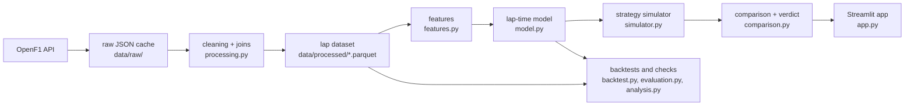

# PitWall

A small F1 race-strategy simulator built on historical timing data. Pick a race and a car, and
PitWall shows the strategy that car really ran, then estimates how its race time would have changed
under a few other pit strategies, and how far to trust the comparison.

**Live demo: <https://pitwall-formula1.streamlit.app/>** (free hosting; it sleeps after about 12 hours without visitors, so the
first load can take a while).

A learning project, not affiliated with Formula 1, the FIA or FOM. It estimates lap-time loss that
goes with tyre age under a simple model. It does **not** find the best strategy.

## What it answers

> What would this driver's total race time have been if they had pitted on different laps, or used
> different compounds?

The app (`app.py`) gives, for one car in one race:

- a one-line verdict: does the model prefer another strategy, is that bigger than the model's own typical
  error, and does it hold when the model is refitted on different races (see [Evaluation](#evaluation));
- a dot-and-range chart of each alternative's time against the real strategy;
- a lap-by-lap chart of where the time is won or lost (pit stops are steps, tyre age is the slope);
- your own strategy, typed in and checked (wrong number of stops, one compound only, pit laps out of
  order and so on give a plain error, not a crash);
- traffic and safety cars, replayed from what really happened in the race.

Comparisons are between strategies for **one car in one race**. PitWall does not compare drivers and
does not estimate finishing positions.

## Setup

Requires [uv](https://docs.astral.sh/uv/) (it installs the pinned Python 3.13 and dependencies).

```bash
uv sync
uv run pytest -q                      # tests never call the live API
```

The three small processed files the app needs (`data/processed/`, about 1 MB, derived from the OpenF1 API) are in
the repository, so a fresh clone runs the app. The raw API cache (about 46 MB) is not:

```bash
uv sync && uv run streamlit run app.py
# or in a container:
docker build -t pitwall . && docker run -p 8501:8501 pitwall
```

To rebuild the data from the OpenF1 API:

```bash
uv run python scripts/fetch_races.py         # caches raw JSON in data/raw/: 70 races, about 350 requests, 3 s apart (~20 min)
uv run python scripts/build_dataset.py       # data/processed/lap_dataset.parquet + docs/DATA_QUALITY.md + docs/RACE_SELECTION.md
uv run python scripts/build_driver_names.py  # data/processed/driver_names.json (optional: car numbers otherwise)
uv run python scripts/build_neutralisations.py # data/processed/neutralisations.json (safety-car windows; races with one are hidden without it)
```

Deploying to AWS (Docker on EC2): [`docs/DEPLOY.md`](docs/DEPLOY.md).

Every API response is cached and the fetch is resumable, so re-running only fetches what is missing.
`uv run python scripts/evaluate.py` prints the numbers quoted below.

## How it works



| Module | Job |
|---|---|
| `ingestion.py` | Find the races, fetch and cache OpenF1 endpoints (laps, stints, race control, weather, drivers) |
| `processing.py` | Join laps to stints, label every lap with exclusion reasons, decide which whole races are usable, build the dataset, quality report |
| `features.py` | Lap time relative to the driver's median clean lap (the target), race fraction (fuel proxy) |
| `model.py` | Pooled linear model: compound, tyre age, race fraction, per compound-and-circuit wear adjustments pulled toward a shared rate |
| `analysis.py` | Pit loss and lap-1 loss per circuit, residual trends, observed tyre-age ranges |
| `simulator.py` | A strategy becomes predicted lap times and a race total; validation; out-of-range flags |
| `traffic.py` | Lap-time penalty by gap to the car ahead; the real field replayed from lap start times |
| `neutralisation.py` | Safety-car and virtual-safety-car windows; the field's real lap times on those laps; the cost of a stop under a real safety car |
| `backtest.py`, `evaluation.py` | Real strategies run through the simulator; leave-one-stint-out; metrics and train/test splits |
| `agent.py`, `agent_tools.py`, `agent_eval.py`, `llm.py` | The what-if agent: its tool-use loop, its three tools, the deterministic grading of its answers, and the provider clients (OpenRouter, Anthropic) |
| `comparison.py` | The candidate strategies, rankings, sensitivity, refits of the model, verdict: everything the app displays |

The app only displays; every number comes from `comparison.py`.

### The model, in plain words

Each lap's time is predicted as the driver's own median clean lap plus a delta:
`delta = compound offset + tyre-age slope × tyre age + fuel term × race fraction`. The fuel term also
absorbs the track getting faster. Tyre age restarts at each stop; race fraction does not. The wear
slope is shared, with a small adjustment per compound at each circuit (partial pooling, so a pair
with few laps stays close to the shared rate). **This is tyre-age-associated lap-time loss, not
physical tyre wear.**

A strategy is a plain dict: compounds per stint and the laps pitted on. A stop costs the circuit's
pit loss (pit-lane time minus the same stretch at racing speed, measured per circuit).

## Data

- Source: the [OpenF1](https://openf1.org) API, historical data only. **OpenF1 has no data before
  2023**, so the 2022 season (the first of the current regulation period) is not available; the dataset
  covers 2023, 2024 and 2025.
- 70 Grands Prix were held in 2023-2025; **57 are used** (17, 19 and 21 per season, 24 circuits):
  62,959 laps, 54,273 of them clean (not lap 1, a pit in-lap or out-lap, a safety-car lap, a retirement
  lap or a lap with missing data). Every race is listed with the reason it was kept or left out in
  [`docs/RACE_SELECTION.md`](docs/RACE_SELECTION.md); counts and every lap exclusion rule are in
  [`docs/DATA_QUALITY.md`](docs/DATA_QUALITY.md).
- 13 races are left out: 8 with a red flag before the chequered flag (a free tyre change and a standing
  restart, not modelled) and 8 where any car ran an intermediate or wet tyre (the simulator is dry-only);
  3 of them are both.
- 35 of the 57 had a safety car or virtual safety car (25 a real one). They are replayed (see below),
  and the model is never trained on those laps.
- **50 of the 57 are offered in the app.** 5 are hidden because no field lap time exists to replay under their
  safety car (every car pitted together), and 2 (Interlagos 2025, Monte Carlo 2025) because their circuit has
  no race in 2023/24 to learn from.
- The three processed files in `data/processed/` are derived from OpenF1's public API data (lap times, stints, race
  control messages, driver names). This is an independent learning project, not affiliated with Formula 1, the FIA or
  FOM; check OpenF1's terms before reusing the data.
- Raw data is kept apart from processed data; joins are on `session_key`, `driver_number` and
  `lap_number`, with key-uniqueness and row-count checks.

## Evaluation

Rules: the model is trained on 2023 and 2024, and 2025 is never used to choose or tune anything (it is
reported). Never a random split of laps within a race. Choices are made with leave-one-year-out on 2023/24
(fit on one year, score the other). On the 57-race corpus a shared wear rate, the pooled model (alpha 1e5) and
alpha 1e4 / 1e6 are essentially tied (cross-year clean-lap MAE 0.556 to 0.568 s, race totals 11.3 to 11.7 s), while
fully free per-circuit wear is clearly worse (0.623 s, 18.0 s), so the pooled model stays.

**Lap-time model**, 2025 races (out of sample, 17,981 clean laps), seconds per lap, against predicting
"every lap is the driver's normal lap":

| | Clean laps MAE | RMSE | Bias | All racing laps MAE |
|---|---:|---:|---:|---:|
| Zero baseline | 0.816 | 1.264 | -0.011 | 0.947 |
| PitWall model | **0.599** | 1.063 | +0.145 | **0.716** |

13% of 2025 laps are left out because their compound-at-circuit pair has no 2023/24 laps. The model is
worse than the baseline on tyres 30+ laps old (MAE 0.81 vs 0.70 s, bias +0.46 s: predicted too slow). On
2023/24 cross-year the same bias is smaller but present (+0.19 s at 30+ in both held-out years), so the
model overstates the cost of long stints, more so in 2025.

**Whole-race backtest**: each driver's real strategy run through the simulator, safety-car-free 2023/24
races, each scored by a model fitted on the other year (179 driver-races in 14 races): mean absolute error
per race total **9.75 s** (0.18 s per lap) with the car's pace taken from its first half and traffic on;
9.89 s without traffic; 11.64 s when the pace is taken from the whole race, which already contains the
strategy being tested.

**Can the model get the cost of a stint right anywhere in the race?** Each stint is predicted from the same
car's *other* stints, so this covers the whole race and first stints (strategy spans the whole race, and the
second-half check below does not):

| | Stints (cars) | Stint-total error | Without tyre/fuel effects |
|---|---:|---:|---:|
| 2023/24 cross-year | 1,318 (506) | **7.7 s**, median 5.3 s | 25.6 s |
| 2025 | 801 (332) | **8.2 s**, median 5.6 s | 29.5 s |

The model removes most of the first-stint (about 1.5 s/lap slower) and last-stint (about 1.4 s/lap faster)
structure. What is left: first stints are predicted 0.17 s/lap too fast cross-year (0.12 on 2025) and last
stints are about right, so the model underestimates how slow heavy-fuel first stints are (about 3 s over a
stint). **A typical stint-level error of about 5 s is why a gap smaller than that can't be told from noise.**

**Strategy gaps between two different cars, second half of the race only.** Each car's pace is taken from its
first half and only the second half is scored, because a car's whole-race pace already contains its strategy.
It cannot test first-stint choices:

| | Gap error | "No strategy effect" error | Picks the faster car (real gap > 5 s) |
|---|---:|---:|---:|
| 2023/24 cross-year (961 pairs), traffic on | 11.1 s | 13.3 s | 69% |
| 2025 (445 pairs), traffic on | 9.2 s | 15.7 s | 85% |

By size of the predicted gap the faster car is picked about 45-60% of the time under 5 s (a coin flip),
71-75% between 5 and 10 s, and 85% (2023/24) to 99% (2025) above 10 s.

**Traffic** is a lap-time penalty that depends on the gap to the car ahead, estimated from lap start times: a
lap starting within half a second of another car is about +0.5 s slower than an average lap, falling to nothing
beyond about 2 s ([DECISIONS](DECISIONS.md), 2026-11-18). It improves the second-half gap error by 0.3 s
(2023/24) and 0.8 s (2025) and the whole-race backtest by 0.1 s. It was checked on real strategies only; how
well it describes an alternative cannot be checked (there is no real data for one), and the other cars never
react.

**Safety cars** are replayed, not predicted. On a lap under a safety car or virtual safety car the simulator
uses the field's real lap time. A stop whose in-lap is under a *real* safety car costs about 65% of the
circuit's normal pit loss (median of 102 real stops, quartiles 45% to 95%); a stop under a *virtual* one costs
the normal amount (23 stops in the training years: median 98%, quartiles 72% to 115%). Whole-race backtest on
the 22 replayable safety-car races (each scored by a model fitted without its own year; 312 cars):

| Treatment of the neutralised laps | All 22 races | 10 races in 2025 (out of sample) |
|---|---:|---:|
| Simulated as normal racing | 162.3 s | 183.3 s |
| Replay the field's lap times | 17.3 s | 15.4 s |
| Replay lap times and cheaper safety-car stops | **17.0 s** | **15.1 s** |

Replaying the lap times is what matters. The cheaper stops are a small gain (they help 7 races, hurt 4 and
leave 11 unchanged). Race totals in these races are less accurate than in normal ones, and the strategy-gap
checks above were not repeated for them.

**Prediction intervals with measured coverage** (split conformal prediction, 80% nominal; `src/pitwall/conformal.py`). An
interval is the prediction plus or minus the 80th percentile of the model's absolute error on races it hadn't seen. The
test is whether it then covers 80% of the real values in 2025, which the calibration never saw ("calibrated once"), and
when the calibration is updated after every 2025 race in date order ("race by race"):

| Interval for | Half-width | Errors it is calibrated on | 2025 coverage, once | 2025 coverage, race by race |
|---|---:|---:|---:|---:|
| A clean lap time | ±0.87 s | 44,334 laps | 79% | 79% |
| A race total, no safety car | ±17.2 s | 262 driver-races | **71%** | **73%** |
| A race total, safety car | ±26.7 s | 312 driver-races | 89% | 89% |
| The gap between two real cars (second half) | ±15.9 s | 1,406 pairs | 89% | 88% |

Lap times are well calibrated. Race totals are not: they cover 73%, not 80%. The reason is a shift between seasons, not
the method: 2025 race totals were predicted about 5 s too slow on average (mean error +4.8 s, against +1.0 s in
2023/24), the same old-tyre bias described above. Calibrating on only the most recent races didn't fix it robustly
(windows of 10 to 30 races: 73-75%; a 6-race window reached 81% but only by widening to ±20 s on about 40 errors), so the
real fix is in the model. The gap interval is conservative (it covers more than 80%) because the pairs also differ in
pace and traffic; for one car the stint-level error (about 5 s) is the better guide. The app shows each interval next to
its measured coverage.

**The verdict** combines two things. The best alternative's gap must exceed the model's typical stint error
(5.3 s). And the alternative must stay faster when the model, pit loss and traffic penalty are refitted on 20
different random 80% subsets of the training races: in 90% or more of them for "prefers", 70% or more for
"leans". Smaller or less stable gaps are "too close for the model to call". This measures how much the answer
depends on which races the model saw; it is not the probability that the alternative really was faster.

## What-if agent (optional, command line)

A language model that answers questions like "what if Norris had pitted on lap 20 at Monza 2024?" by calling the simulator as a
tool (`src/pitwall/agent.py`, `agent_tools.py`). It does the language; the simulator does every calculation. Three tools:
`list_races`, `list_cars` and `compare_strategy`, which return compact JSON (the verdict, each alternative's gap and range, how
many refits agree, the calibrated intervals, caveats). Problems come back as readable errors ("Monte Carlo 2024 isn't available:
a red flag stopped the race"), not as exceptions.

```bash
export OPENROUTER_API_KEY=sk-or-...      # one key for many models; no extra install, standard library only
uv run python scripts/ask.py "What if Leclerc had pitted on lap 20 at Monza 2024?" -v
```

It uses Claude Sonnet 5.5 through OpenRouter by default (`--model` to change; `--provider anthropic` talks to Anthropic directly
and needs `uv sync --extra agent`). The loop in `agent.py` doesn't know which provider answers: `llm.py` has one small client per
provider behind the same interface. It runs only from the command line: nothing public, so no hosting cost and no one else spends
your credit. The system prompt's rules are what the evaluation checks: every number must come from a tool
result, never "optimal", ask when the race or car is missing, and decline what the simulator can't do (finishing positions,
comparing drivers, 2022 or 2026, wet or red-flag races, hypothetical safety cars).

**Evaluation.** 40 questions (`evals/agent_questions.jsonl`): 14 with a named strategy, 6 open "should he have..." questions, 5 lookups,
10 that must be declined, 5 that must be answered with a question. Grading is deterministic (`src/pitwall/agent_eval.py`, no model
as judge): the right tool with the right arguments (race and car compared after resolution), every number in the answer present in
a tool result or the question (rounding allowed), no optimality claims (negation-aware), a decline or a question where one is due.
The harness itself is checked with controls: a scripted agent that does exactly what each case expects scores 40/40, and a careless
one that never calls a tool and invents numbers scores at most 2/40 (`tests/test_agent_controls.py`). Live results, run through OpenRouter on 2026-11-18 (full reports: [`docs/AGENT_EVAL_sonnet.md`](docs/AGENT_EVAL_sonnet.md),
[`docs/AGENT_EVAL_haiku.md`](docs/AGENT_EVAL_haiku.md); the first runs, before one tool fix, are the `_run1` files):

| Model | Passed (run 1, then run 2) | Cost of 40 questions |
|---|---|---:|
| Claude Haiku 5.5 | 38 / 40, 38 / 40 | $0.03 |
| Claude Sonnet 5.5 | 38 / 40, 39 / 40 | $0.50 |

Both models got all 20 strategy questions (named and open) right on tool, arguments and numbers. The failures were not wrong
strategy numbers: three were correct list counts the tool didn't state (fixed by returning the counts, which is why run 2 differs),
two were an illustrative example number in a clarifying question ("for example, car 16"), and one is a real model miss that repeated in both Haiku runs:
asked to simulate Monaco 2024, Haiku asks which tyres to use instead of first checking the race is available. 40 questions
written by the same author as the grader cannot separate 38 from 39, and the second run followed a fix made after reading the first,
so it is not a clean held-out test. Haiku matched Sonnet here at about 6% of the cost.
What the grader can't catch: a number that is in a tool result but used wrongly (for example reading a negative gap as slower).

## Reading the results

- **A gap is not an instruction.** The model only knows tyre age, fuel, traffic and safety cars, so it tends to
  favour evenly split stints. Real teams pit for undercuts, tyre allocation and sudden tyre drop-off, none of
  which it sees. A "the model prefers X" verdict means exactly that.
- **Traffic is on by default** and can be switched off in the sidebar to see what it changes.
- **Gaps are more reliable than totals.** Much of the model's error is shared by every strategy in a race and
  cancels in a gap.
- **The range bars** show how the gap moves with pit loss (25th to 75th percentile at that circuit) and tyre
  wear (±0.047 s per lap of tyre age, the 75th percentile of the leftover wear error on a year the model did not
  see).
- **A warning triangle** marks a strategy that runs tyres older than any seen at that circuit; its number is an
  extrapolation and never counts in the verdict.

## Limitations

- **Safety cars** are replayed from what happened and never predicted: there is no "what if a safety car had
  come out". The other cars keep their real reaction. Race totals in safety-car races are about 17 s off against
  about 10 s elsewhere, and the strategy-gap checks mix races with and without one.
- **Traffic** is a simple replay of the real field with a penalty close behind another car. There is no
  overtaking logic, the other cars never react, and the training laps that were run in traffic are not removed
  (the penalty is relative to an average lap).
- **Race-total intervals under-cover on a new season** (73% against 80% nominal in 2025); they will be recalibrated
  after the model is improved.
- **Strategy gaps are not validated against the same car on two strategies**: no such data exists. The checks
  use pairs of different cars (second half only) and a car's own stints (whole race).
- **Track evolution** is folded into the race-fraction term; it cannot be separated from fuel burn, and the term
  under-predicts heavy-fuel first stints by about 0.15 s per lap. I tried to fix this
  and the old-tyre bias with 13 model variants (curved fuel and wear terms, a new-tyre warm-up term, track temperature) and a
  gradient-boosting benchmark, scored on 2023/24 only ([`docs/MODEL_ABLATION.md`](docs/MODEL_ABLATION.md)): none moves the lap
  error by more than 0.01 s or removes either bias, so the simple linear model stays. The leftover looks specific to each race.
- **Old tyres** (30+ laps) lost less time than the model predicts, in both periods and more in 2025.
- **No driver-specific tyre wear**: a driver sets the pace level and the real strategy; the alternatives rank
  the same way for every driver in a race.
- **No 2022 data** (OpenF1 starts in 2023), and no wet or red-flag races, so those conditions are not covered.
- **Alternatives use new tyre sets** after the first stint.
- No claim of an optimal strategy, and no causal claim about tyre degradation.

## Project notes

`CLAUDE.md` holds the working rules, `docs/PITWALL_PLAN.md` the roadmap, `docs/SPEC.md` the one-page
spec, `NOTES.md` a short log per session and `DECISIONS.md` every real design decision with the
alternatives considered.
